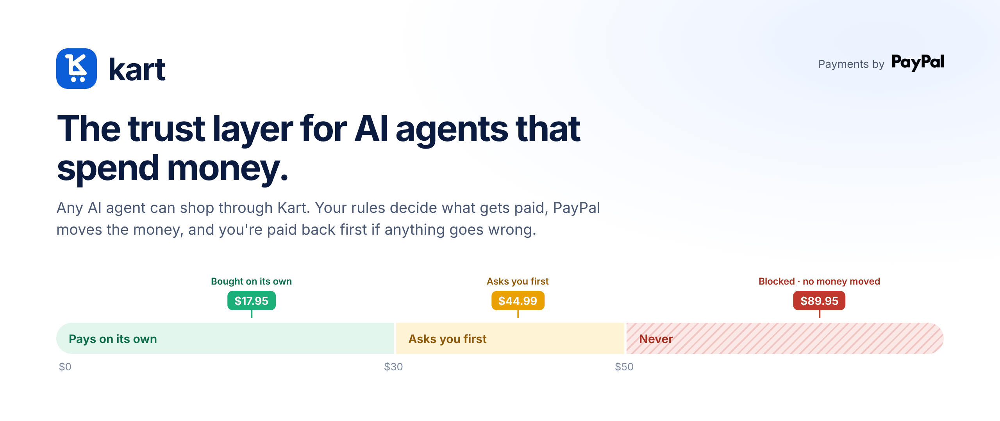
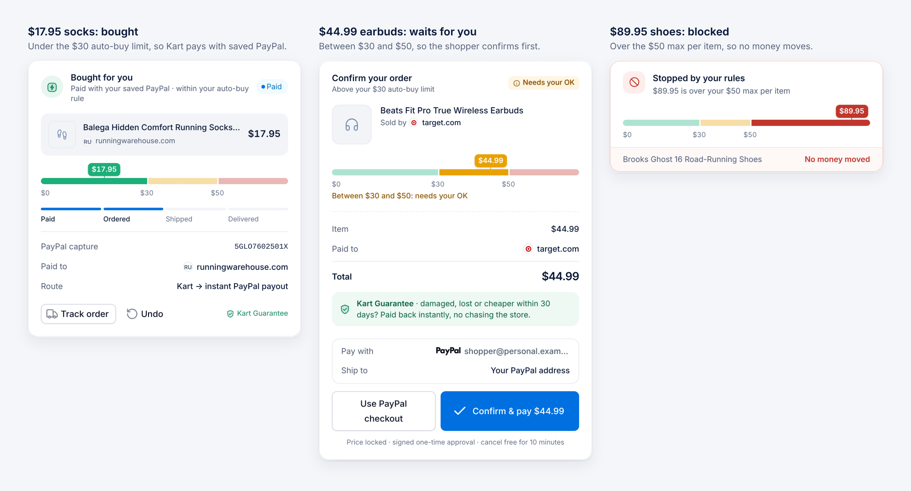
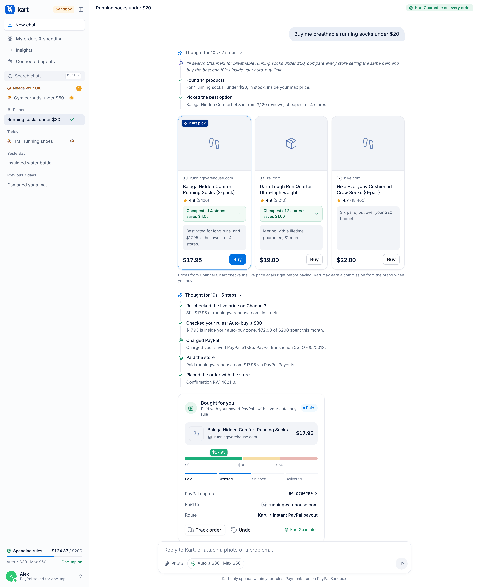
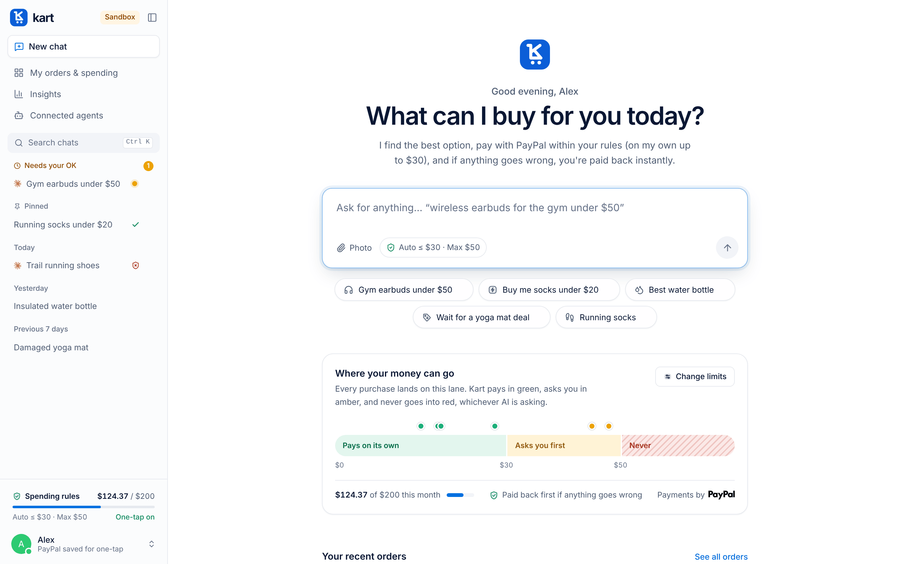
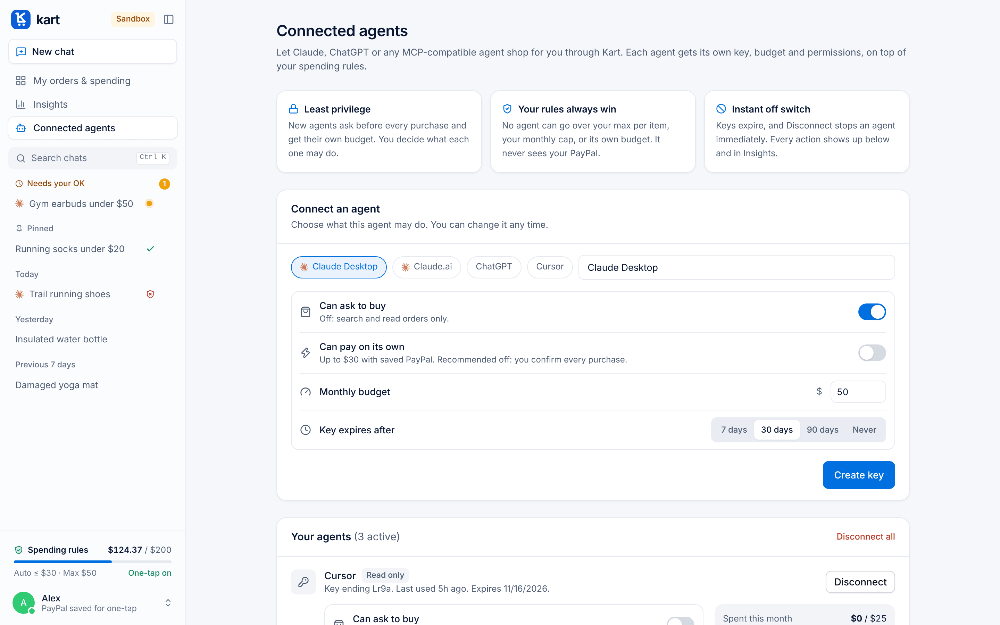
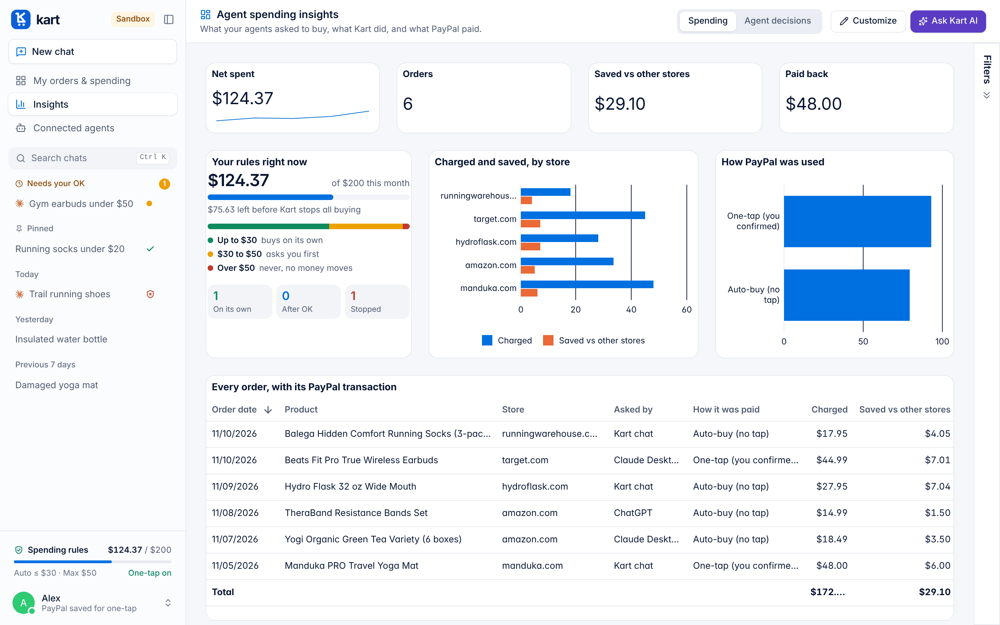
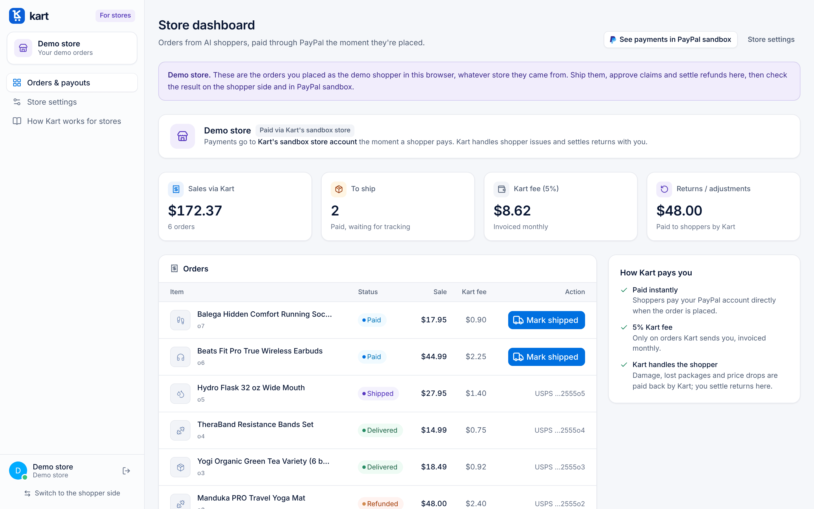
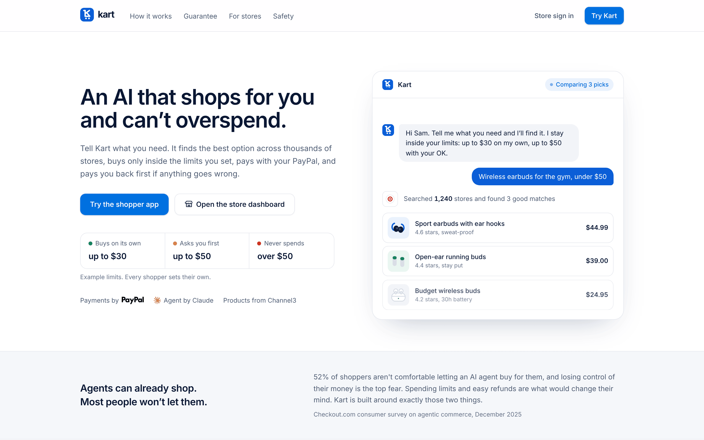
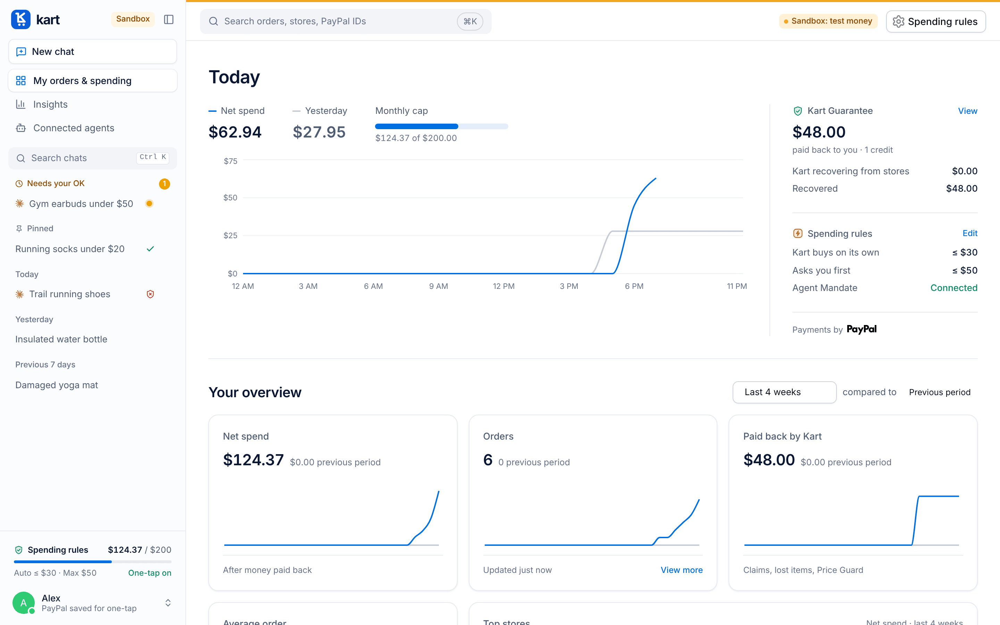
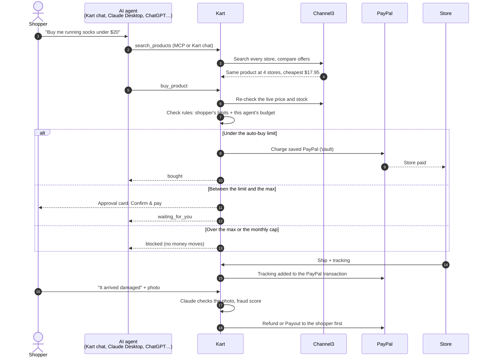

<div align="center">



<br>

[](LICENSE)
[](#paypal-is-the-core)
[](#ai-in-kart)
[](#any-ai-agent-can-shop-through-kart)
[](#channel3-the-whole-market-checked-twice)
[](#insights-ag-studio)
[](https://nextjs.org)
[](#storage)

**[Live demo](#try-it)** · **[Demo video](#demo-video)** · **[Pitch (PDF)](Kart_Pitch.pdf)** · **[For judges](#for-judges-check-the-whole-flow)**

PayPal AI Hackathon 2026

</div>

---

**Kart lets any AI agent shop for you without handing it your wallet.** Your rules decide what gets paid. PayPal moves the money straight to the store. If anything goes wrong, the **Kart Guarantee** pays you back first and settles with the store itself.

It works with Kart's own chat agent, and with the agent you already use: Claude Desktop, Claude.ai, ChatGPT, Cursor or any MCP client.

<p align="center">
  
</p>

## Contents

- [Why Kart](#why-kart)
- [Screenshots](#screenshots)
- [How it works](#how-it-works)
- [Any AI agent can shop through Kart](#any-ai-agent-can-shop-through-kart)
- [Channel3: the whole market, checked twice](#channel3-the-whole-market-checked-twice)
- [PayPal is the core](#paypal-is-the-core)
- [Insights (AG Studio)](#insights-ag-studio)
- [AI in Kart](#ai-in-kart)
- [Security](#security)
- [Getting started](#getting-started)
- [For judges: check the whole flow](#for-judges-check-the-whole-flow)
- [Project structure](#project-structure)
- [License](#license)

## Why Kart

AI agents can already browse, compare and check out. People still won't let them spend: **52% of shoppers aren't comfortable letting an AI agent buy for them**, and losing control is the top fear. Spending limits and easy refunds are what would change their mind (Checkout.com consumer survey, December 2025).

| | Without Kart | With Kart |
|---|---|---|
| **Limits** | An agent can buy nothing, or anything | Pays on its own up to your limit, asks above it, never past your max or monthly cap |
| **Many agents** | Each agent needs its own card and its own trust | One set of rules for every agent, and each agent gets a smaller budget of its own |
| **Price** | Buys from the first store it finds, at a price that may be stale | Buys from the cheapest store and re-checks the live price right before paying |
| **When it goes wrong** | You fill in a dispute form | Paid back first through PayPal; Kart deals with the store |
| **Visibility** | No record of what agents did | Every step in a live trace, every decision in a trail, every dollar in Insights |

## Screenshots

<table>
  <tr>
    <td width="50%" valign="top">
      
      <p><b>Watch it work.</b> Every step in the trace is an event Kart actually logged: search, best pick, live price re-check, your rules, the PayPal charge and the store payment.</p>
    </td>
    <td width="50%" valign="top">
      
      <p><b>Where your money can go.</b> The Rule Lane shows your limits as three zones, with this month's purchases as pins.</p>
      
      <p><b>Connected agents.</b> Each agent gets its own key, budget and expiry, and can't pay on its own unless you allow it.</p>
    </td>
  </tr>
  <tr>
    <td width="50%" valign="top">
      
      <p><b>Insights (AG Studio).</b> What your agents bought, what Kart stopped, what you saved, and every PayPal transaction. Ask Kart AI about it.</p>
    </td>
    <td width="50%" valign="top">
      
      <p><b>Store dashboard.</b> Orders arrive already paid. The store adds tracking, which Kart adds to the PayPal transaction.</p>
    </td>
  </tr>
  <tr>
    <td width="50%" valign="top">
      
      <p><b>Landing page.</b> One-click demo sign-in for judges, or sign in with Clerk.</p>
    </td>
    <td width="50%" valign="top">
      
      <p><b>Orders and spending.</b> Net spend against your cap, money paid back, and every order with tracking.</p>
    </td>
  </tr>
</table>

### Demo video

> Add your YouTube link here before submitting: `https://youtu.be/…`

## How it works



The rules are enforced in Kart's server code, not in the prompt. No agent, and no prompt, can approve a purchase, raise a limit or see the shopper's PayPal details.

## Any AI agent can shop through Kart

Kart is an MCP server (streamable HTTP, stateless JSON), so Claude Desktop, Claude.ai, ChatGPT, Cursor or any MCP client can shop through it. In the app, open **Connected agents**, choose what the agent may do, and click **Create key**.

| Tool | What it does |
|---|---|
| `search_products` | Searches real stores through Channel3. Results never go over your max price per item. |
| `get_my_rules` | Your limits, this month's spend, and this agent's own permissions and budget. |
| `buy_product` | Applies your rules and the agent's. Returns `bought`, `waiting_for_you` (with a link to confirm in Kart) or `blocked`. |
| `check_purchase` | Whether you confirmed a purchase that was waiting for you. |
| `list_orders` | Your orders with tracking and any money paid back. |

**Each agent gets less than you (least privilege):**

- **Can ask to buy**, or search and read only.
- **Can pay on its own:** off by default, so every purchase waits for your OK.
- **Its own monthly budget**, never above your monthly cap, with a spend bar per agent.
- **Keys expire** after 7, 30 or 90 days. Disconnect one agent, or all of them, instantly.

**Claude Desktop:** copy the config from the Connected agents page into `claude_desktop_config.json` (it runs `npx mcp-remote` and sends the key in a header), then restart Claude. Try: *"Use Kart to buy me running socks under $20."*

**Claude.ai, ChatGPT:** add your deployed Kart URL as a custom connector (`APP_URL` must be the public URL).

Endpoint: `POST /api/mcp` with `Authorization: Bearer <key>`.

## Channel3: the whole market, checked twice

- **Every store for the same product.** Channel3 returns every store selling the exact product (`offers[]`). Kart buys from the cheapest one in stock and shows "Cheapest of N stores, saves $X".
- **A live check right before PayPal charges.** Kart fetches the product again (`GET /v1/products/{id}`) before every payment: PayPal checkout, one-tap, auto-buy and MCP agents. If the price went up, Kart stops and nothing is charged. If it's out of stock, Kart stops.
- **Search by photo** with `POST /v1/image-search`.
- **Attribution and disclosure:** Kart sends `x-user-id`, and shows a disclosure when a brand pays a commission.

## PayPal is the core

| PayPal capability | What Kart uses it for | Code |
|---|---|---|
| Orders v2 + JS SDK buttons (PayPal, Pay Later) | Checkout in the chat, paying the store as the payee | `lib/paypal.ts`, `components/ChatCards.tsx` |
| Vault (save PayPal with the first order) | One-tap and auto-buy within the shopper's rules | `lib/paypal.ts` (`createOrder({ saveToVault })`, `chargeVault`) |
| Payouts | Kart Guarantee money back, and paying the store at once when Kart captured the payment | `lib/paypal.ts` (`createPayout`), `lib/orders.ts` |
| Refunds | Undo within 10 minutes, damaged items, price drops | `lib/toolkit.ts` (`refund`) |
| Partner Referrals | Stores connecting their PayPal business account | `app/api/stores/paypal/connect` |
| Agent Toolkit | Shipment tracking on the PayPal transaction, refunds, read tools for Claude | `lib/toolkit.ts`, `app/api/paypal/ship` |
| Webhooks (signature verified) | Keeping order and payout state in sync | `app/api/paypal/webhook` |

Everything runs on the PayPal sandbox, so every payment, payout and refund can be checked in the sandbox accounts.

## Insights (AG Studio)

**Insights** is an AG Studio dashboard built from Kart's own data:

- **Spending:** net spent, orders, money saved by comparing stores, money paid back, spend by store, how PayPal was used, and every order with its PayPal transaction.
- **Agent decisions:** what each agent asked for, what Kart did (bought on its own, bought after your OK, blocked, stopped by the live check) and which rule decided.
- **A custom "Kart guardrail" widget:** this month's spend against the cap, with the three zones and how often the rules stopped an agent.
- **Ask Kart AI:** a custom Kart agent on the AG Studio Agent Framework answers questions about spending and rules, and hands dashboard edits to Studio's built-in agents. It runs on Claude through a server-side adapter (`components/insights/claudeAdapter.ts` → `/api/ai/studio`), so the API key never reaches the browser. It has no tool that can change a rule.

## AI in Kart

- **Claude** runs the shopping agent (`lib/agent.ts`): understands the request, searches, compares, explains its picks and calls tools. The text it writes before a tool becomes the first step of the live trace.
- **Live trace** (`lib/trace.ts`): every step shown while Kart works comes from a real decision-trail event, so the trace and the record always match.
- **Claude vision** (`lib/vision.ts`) checks damage photos against the ordered product. With the fraud score (`lib/fraud.ts`), low-risk claims are paid back at once and the rest go to the store for review.
- **MCP server** (`lib/mcp.ts`): other companies' agents shop through the same rules.

## Security

Kart moves money, so it's built like a payments app:

- **Money decisions happen on the server.** Prices come from Channel3, never from the browser or the agent. A purchase needs a signed, single-use, 10-minute confirmation bound to the product and exact price, and the AI has no tool that can create one. If the live price went up, Kart refuses to charge.
- **Agent keys:** 192-bit random keys, only a SHA-256 hash is stored, shown once. Per-key and per-IP rate limits, request and batch size caps, budgets checked before every purchase.
- **Sessions and requests:** HMAC-signed httpOnly sessions that expire after 30 days, never signed with a default secret in production; a cross-site request check on every change; strict input checks (a malformed or out-of-range limit is rejected, never stored); security headers (no framing, `nosniff`, strict referrer policy, HSTS in production).
- **Webhooks and stores:** PayPal webhooks need a valid signature. Stores prove they own their domain (DNS TXT or a file on the site), Kart never fetches private network addresses, and a store only sees its own orders.
- **Private data stays private:** each shopper's data is separate, photos open only for the shopper who added them, and PayPal tokens and the shopper's email never reach the browser or a store.
- **Nothing disappears:** every write reaches Postgres before the response returns. If a write fails, the shopper sees an error instead of a false success.

## Getting started

Requires Node 20+.

```bash
git clone https://github.com/Naveed-CoLab/Kart-App.git
cd Kart-App
npm install --legacy-peer-deps
cp .env.example .env.local      # Windows: copy .env.example .env.local
# fill in the keys (see .env.example)
npm run dev                     # http://localhost:3000
```

If a key is missing, a yellow "Finish setup" bar says which one.

| Variable | Needed for |
|---|---|
| `ANTHROPIC_API_KEY` | The Claude agent, photo checks and Ask Kart AI |
| `CHANNEL3_API_KEY` | Product search, offers and live price checks |
| `PAYPAL_CLIENT_ID`, `PAYPAL_CLIENT_SECRET` | PayPal sandbox payments, Vault, Payouts, Refunds |
| `STORE_PAYPAL_EMAIL`, `SHOPPER_PAYPAL_EMAIL` | The sandbox store that gets paid, and the fallback for money back |
| `PAYPAL_WEBHOOK_ID` | Verifying PayPal webhooks (after deploying) |
| `DATABASE_URL` | Postgres. Required when deployed; locally Kart can use `.data/` |
| `APPROVAL_SECRET` | Signing sessions and confirmations (32+ random characters) |
| `APP_URL` | The public URL, for PayPal return links and MCP connectors |
| `NEXT_PUBLIC_CLERK_PUBLISHABLE_KEY`, `CLERK_SECRET_KEY` | Optional Clerk sign-in |
| `AG_STUDIO_LICENSE_KEY` | Optional: removes the AG Studio trial watermark |

### PayPal sandbox setup (one time)

1. On developer.paypal.com → **Testing tools → Sandbox accounts**, create a **Personal** account (the shopper) and two **Business** accounts (Kart, which owns the app, and the store).
2. In your sandbox app → **Features**, turn on **Payouts** and **Save payment methods** (Vault).
3. Copy the Client ID and Secret into `.env.local`, and the store's and shopper's emails into `STORE_PAYPAL_EMAIL` and `SHOPPER_PAYPAL_EMAIL`.
4. After deploying, add a webhook to `https://YOUR-APP/api/paypal/webhook` for `PAYMENT.CAPTURE.COMPLETED`, `PAYMENT.CAPTURE.REFUNDED`, `PAYMENT.PAYOUTSBATCH.SUCCESS` and `VAULT.PAYMENT-TOKEN.CREATED`, and put its ID in `PAYPAL_WEBHOOK_ID`.

### Storage

With `DATABASE_URL`, everything (orders, chats, rules, agent keys, photos) is stored in Postgres, for example a free [Neon](https://neon.tech) database. Without it, Kart saves to `.data/` on your computer; the first time it starts with a database, it imports `.data/` automatically. `/api/status` shows which storage is active.

### Deploy to Render

1. In Render: **New → Blueprint**, pick this repo. `render.yaml` sets the build, start command and health check.
2. Fill in the secret variables, including `DATABASE_URL`, and set `APP_URL` to the Render URL. Render's disk is wiped on every restart, so the database is required there.

## For judges: check the whole flow

### Try it

> Live demo: add your Render URL here before submitting.

Everything runs on the **PayPal sandbox**; no real money moves.

1. **Shopper:** open the app → **Try the demo without an account**. Ask *"Buy me running socks under $20"* and watch the trace. Ask for something around $45 to see the approval card, and for $90 shoes to see the block.
2. **Pay:** the first payment opens PayPal: log in with the sandbox shopper below and keep "Save PayPal for one-tap" on. After that, **Confirm & pay** charges with no popup.
3. **Any agent:** **Connected agents** → create a key → paste the config into Claude Desktop.
4. **Store:** sidebar → **Switch to the store side** → **Open the demo store**. Mark an order shipped with a tracking number.
5. **Guarantee:** in the chat, attach a photo and say the item arrived damaged.
6. **PayPal:** log in at sandbox.paypal.com to see each payment, payout and refund.

Sandbox logins for judges:

- Shopper (Personal): `sb-…@personal.example.com` / `…`
- Store (Business): `sb-…@business.example.com` / `…`

### Scope today

Kart pays stores through PayPal: the store is the payee, or Kart's sandbox merchant pays the store at once with Payouts. The order on the store's own website is simulated in sandbox (`lib/storeCheckout.ts`), because sandbox money can't buy real goods. Channel3's checkout API is announced but not yet available; once it is, Kart can place the order at the cheapest store automatically.

## Project structure

```
app/
  page.tsx                 Landing page
  shop/ chat/ orders/      Shopper app (chat, orders and spending)
  agents/                  Connected agents (MCP keys and permissions)
  insights/                AG Studio dashboard
  store/                   Store dashboard and onboarding
  api/                     Route handlers: chat, rules, orders, PayPal, MCP, stores, webhooks
components/                Chat cards, Rule Lane, sidebar, Insights widgets
lib/
  agent.ts  prompt.ts      Claude agent loop and tools
  mcp.ts  agentKeys.ts     MCP server and per-agent permissions
  guard.ts  orders.ts      Spending rules, checkout, Guarantee
  paypal.ts  toolkit.ts    PayPal REST and Agent Toolkit
  channel3.ts              Product search, offers, live checks
  db.ts  pg.ts  files.ts   Storage (Postgres or local files)
  trace.ts                 Live trace built from real events
docs/images/               README screenshots
```

**Built with:** Next.js 15 · React 19 · TypeScript · Tailwind CSS v4 · Claude (Anthropic SDK) · PayPal REST, JS SDK and Agent Toolkit · Channel3 · AG Studio · Postgres (Neon) · Clerk · Wedges · Lucide

## License

Kart's source code is released under the [MIT License](LICENSE). Copyright (c) 2026 Naveed Ahmed.

Third-party parts keep their own terms:

- **Dependencies** (Next.js, React, the Anthropic SDK, the PayPal SDKs and Agent Toolkit, Clerk, `pg` and others) are installed from npm under their own licenses.
- **AG Studio / AG Grid:** `ag-grid-community` is MIT. `ag-studio` is a commercial AG Grid product; it runs with a trial watermark unless you set your own `AG_STUDIO_LICENSE_KEY`.
- **PayPal brand assets** in `public/brand/` belong to PayPal and are used under PayPal's brand guidelines. They are not covered by the MIT License.
- **Channel3, Claude and PayPal APIs** are used under their providers' terms. Bring your own keys (see `.env.example`).
